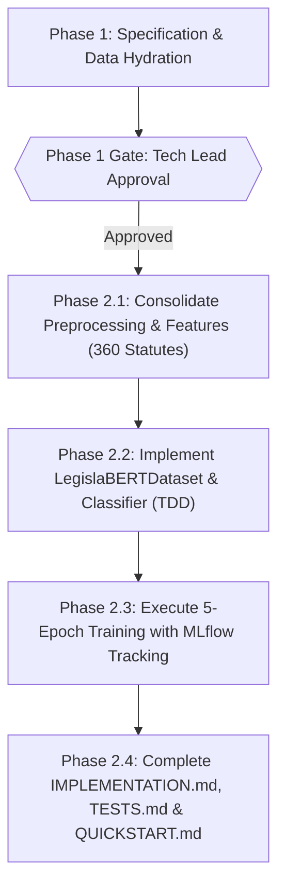

# PLAN — Execution Plan (FEAT-001)

| Metadata | Detail |
| :--- | :--- |
| **Feature** | BERTimbau Fine-Tuning for Veto Risk and Normative Instability Prediction |
| **Identifier** | `FEAT-001` |
| **Phase** | Sprint 0 (Deep Learning & MLOps Foundation) |
| **Owner** | Tech Lead |
| **Status** | Phase 1 — Awaiting Sign-Off |

---

## 1. Work Breakdown Structure (WBS)

---

## 2. Execution Steps

### Step 1: Environment & Historical Data Hydration
- [x] Configure CUDA environment with PyTorch, Transformers, and MLflow.
- [x] Execute smoke test hydration (8 statutes) to verify pipeline contracts.
- [x] Execute historical scraper across 2020–2026 (360 statutes stored in `data/raw/`).
- [ ] Run `src/preprocessing.py` and `src/features.py` over the full 360-statute corpus.

### Step 2: Phase 2 Model Implementation (Pending Phase 1 Approval)
- [ ] Implement `LegislaBERTDataset` with Head-Tail Window sampling ($128 + 382$ tokens).
- [ ] Implement `LegislaBERTClassifier` (`BERTimbau` backbone, `Dropout(0.3)`, affine classifier head returning `(logits, cls_embedding)`).
- [ ] Implement `calculate_class_weights` and the mixed-precision (`fp16`) training loop with gradient accumulation ($B=4, A=4$) and gradient clipping ($\|\mathbf{g}\|_2 \le 1.0$).

### Step 3: Continuous MLOps & Benchmarking (Pending Phase 1 Approval)
- [ ] Instrument `legislabl-bert-v2` experiment in MLflow logging parameters, per-epoch metrics, and `models/best_legislabl_bert_<target>.pt`.
- [ ] Benchmark Macro-F1, Balanced Accuracy, and Minority Recall against the v1 Random Forest baseline.
- [ ] Write `IMPLEMENTATION.md`, `TESTS.md`, and `QUICKSTART.md`.

---

## 3. Risk Matrix & Contingencies

| Risk | Likelihood | Impact | Mitigation Strategy |
| :--- | :--- | :--- | :--- |
| **CUDA VRAM Exhaustion (`OOM`)** | Medium | High | Fall back to `--batch-size 2 --grad-accum 8`, preserving $B_{\text{effective}} = 16$ within a $<2.5\text{ GB}$ footprint. |
| **Late-Epoch Overfitting on Small Corpus** | Medium | Medium | Save checkpoint strictly when validation `f1_macro` improves; discard degraded trailing epochs. |
| **Severe Minority Class Under-Prediction** | Low | High | Enforce inverse-frequency class weights in `CrossEntropyLoss` and evaluate via `val_recall_veto`. |
