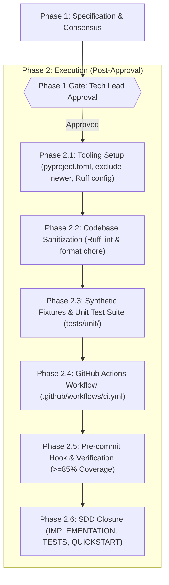

# PLAN — Execution Plan (FEAT-002)

| Metadata | Detail |
| :--- | :--- |
| **Feature** | Continuous Integration, Automated TDD Suite, and Fast Quality Gates |
| **Identifier** | `FEAT-002` |
| **Phase** | Sprint 0 (Foundation & SWE Quality Gates) |
| **Owner** | Tech Lead |
| **Status** | Phase 2 — Implemented & Verified |

---

## 1. Work Breakdown Structure (WBS)

---

## 2. Execution Steps

### Step 1: Specification & Hard Gate (Phase 1 — Current Step)
- [x] Run comprehensive `/grill-me` session with Tech Lead resolving all architectural trade-offs.
- [x] Create branch `feature/002-ci-tdd-pipeline` from `develop`.
- [x] Draft `docs/specs/002-ci-tdd-pipeline/SPEC.md` and `docs/specs/002-ci-tdd-pipeline/PLAN.md`.
- [x] Commit Phase 1 docs atomically: `docs(feat-002): add phase 1 spec and plan for ci-tdd pipeline`.
- [x] **HARD GATE**: Present trade-offs and await explicit Tech Lead sign-off before creating any code or test files.

---

### Step 2: Tooling & Dependency Modernization (Phase 2.1)
- [x] Generate `pyproject.toml` consolidating:
  - Core dependencies (`torch`, `transformers`, `scikit-learn`, `pandas`, `requests`, `mlflow`).
  - Optional development dependencies (`pytest`, `pytest-cov`, `ruff`).
  - Tool configurations: `[tool.ruff]`, `[tool.pytest.ini_options]`, `[tool.coverage.run]`.
- [x] Configure `exclude-newer` in `[tool.uv]` and ignore `uv.lock` in `.gitignore` to keep git history lean.

### Step 3: Ruff Baseline & Code Sanitization (Phase 2.2)
- [x] Run `uv run ruff format .` and `uv run ruff check --fix .` across `src/`.
- [x] Ensure all unused imports and formatting quirks in legacy v1 code are cleanly resolved.
- [ ] Commit formatting baseline atomically: `chore(lint): apply ruff formatting and clean import baseline`.

### Step 4: Synthetic Fixtures & Unit Tests (Phase 2.3)
- [x] Create `tests/fixtures/synthetic_statutes.py` providing dummy statutory strings and mock tokenizers.
- [x] Implement `tests/unit/test_dataset.py` (Seam 1: Head-Tail boundary and tensor dimensions).
- [x] Implement `tests/unit/test_model.py` (Seam 2: `LegislaBERTClassifier` forward pass and logits shape invariant with dummy weights).
- [x] Implement `tests/unit/test_weights.py` (Seam 3: `calculate_class_weights` mathematical properties).
- [x] Implement `tests/unit/test_deduplication.py` (Seam 4: duplicate ID stripping preventing data leakage).
- [x] Implement `tests/unit/test_preprocessing.py` (Seam 5: statutory regex cleaning and token counters).

### Step 5: GitHub Actions CI Workflow (Phase 2.4)
- [x] Create `.github/workflows/ci.yml`:
  - `lint-and-format` job using `astral-sh/setup-uv` executing `ruff check` and `ruff format --check`.
  - `unit-tests` job using `astral-sh/setup-uv` executing `pytest` with `--cov=src --cov-fail-under=85`.
  - Add GitHub Step Summary step displaying test outcome breakdown.

### Step 6: Local Hook, Coverage Validation & SDD Documentation (Phase 2.5 & 2.6)
- [x] Install local `.git/hooks/pre-commit` script running `ruff check` and `ruff format --check`.
- [x] Execute complete suite locally to verify $\ge 85\%$ coverage on business logic.
- [x] Write Phase 2 documentation:
  - `docs/specs/002-ci-tdd-pipeline/IMPLEMENTATION.md`
  - `docs/specs/002-ci-tdd-pipeline/TESTS.md`
  - `docs/specs/002-ci-tdd-pipeline/QUICKSTART.md`

---

## 3. Risk Matrix & Contingencies

| Risk | Likelihood | Impact | Mitigation Strategy |
| :--- | :--- | :--- | :--- |
| **PyTorch CPU Wheel Download Size in CI** | Medium | Medium | Use `astral-sh/setup-uv` caching mechanism to cache wheels across CI runs; runner install time will drop to $<5\text{s}$. |
| **Legacy Code Line Coverage Deficit** | Medium | High | Structure `tests/unit/test_preprocessing.py` and `test_deduplication.py` to exercise all utility branches; configure coverage omit patterns for non-testable CLI boilerplate if needed. |
| **Ruff Auto-Fix Breaking Legacy Logic** | Low | High | Inspect all diffs generated by `ruff check --fix` before committing; ensure zero semantic alterations to business functions. |
| **Slow Test Execution on CPU** | Low | Medium | Ensure tests strictly instantiate mock layers with small hidden dimensions ($d=32$ or mocked linear heads) rather than loading 110M parameter tensors. |
