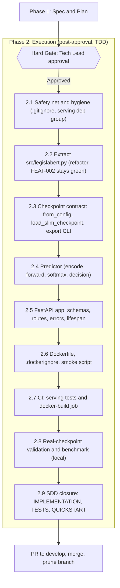

# PLAN — LegislaBERT Model Serving (FastAPI + Docker)

| Metadata | Detail |
| :--- | :--- |
| **Feature** | Containerized CPU inference microservice for the fine-tuned LegislaBERT classifier |
| **Identifier** | `FEAT-003` |
| **Phase** | Sprint 0 (closing the v2 foundation) |
| **Owner** | Tech Lead |
| **Status** | Phase 2 — Implemented & Verified |

---

## 1. Work Breakdown Structure (WBS)

Dependencies are strictly sequential: each step produces the seam the next one tests against. Every step ends with a green `ruff check` and `pytest`, and its own atomic commit.

---

## 2. Execution Steps

### Step 1: Specification & Hard Gate (Phase 1 — current step)
- [x] Inspect `src/train_legislabl_bert.py`, `src/model.py`, `pyproject.toml`, `.github/workflows/ci.yml`, `GLOSSARY.md`, and the FEAT-001/002 specs to ground this design.
- [x] Create branch `feat/003-model-serving` from `develop`.
- [x] Draft `docs/specs/003-model-serving/SPEC.md` and `PLAN.md`.
- [x] **Tech Lead review** of both documents (this turn ends here).
- [x] After approval, commit atomically: `docs(feat-003): add phase 1 spec and plan for model serving`.
- [x] **HARD GATE**: no production or test code before explicit sign-off.

### Step 2: Safety Net & Hygiene (Phase 2.1)
- [x] Run the full FEAT-002 suite on the untouched branch to record the baseline (13 tests, `88.74%`).
- [x] Append `models/` and `*.pt` to `.gitignore`.
- [x] Add dependency group `serving` to `pyproject.toml`: `fastapi`, `uvicorn[standard]`, `pydantic`, `httpx` (for `TestClient`, dev only), reusing the already-declared `torch`, `transformers`, `numpy`.
- [ ] Commit: `chore(ci): add serving dependency group and ignore model artifacts`.

### Step 3: Extract `src/legislabert.py` (Phase 2.2, refactor — FR01, FR02, I1, I7)
- [x] **Red**: write `tests/unit/serving/test_encoding.py` asserting `head_tail_encode` boundaries (`n = 510`, `511`, `1000`, `0`) and that dataset output equals the function output (I1). Tests fail (module absent).
- [x] **Green**: create `src/legislabert.py` with `head_tail_encode`, `LegislaBERTDataset`, `LegislaBERTClassifier` moved **verbatim**; dataset delegates to `head_tail_encode`.
- [x] Update `src/train_legislabl_bert.py` to import and re-export both classes (`__all__` keeps `AutoModel` and `AutoTokenizer` importable, because FEAT-002 tests patch `bert_mod.AutoModel.from_pretrained`).
- [x] **Refactor guard**: run the complete FEAT-002 suite without edits (QG1 / I7). Any required test edit is a spec violation and stops the step.
- [ ] Commit: `refactor(model): extract legislabert module for shared training and serving use`.

### Step 4: Checkpoint Contract (Phase 2.3 — FR03, FR04, FR05, I5)
- [x] **Red** `tests/unit/serving/test_checkpoint.py`:
  - round-trip: build tiny mock classifier ➔ save slim ➔ load ➔ identical `state_dict`;
  - missing `model_state_dict`, wrong `max_length`, shape mismatch, extra/missing keys, `LEGISLA_TARGET` mismatch ➔ typed `CheckpointError`.
- [x] **Green**: add `LegislaBERTClassifier.from_config(...)` (no download) and `src/serving/checkpoint.py::load_slim_checkpoint(path, expected_target)` using `torch.load(map_location="cpu", weights_only=True)` and `load_state_dict(strict=True)`.
- [x] **Red/Green** `tests/unit/serving/test_checkpoint.py` and `src/serving/export.py`: strips `optimizer_state_dict`, adds `target` and `sha256_of_source`, sanitizes `metrics` to plain Python types (risk R1 in SPEC §7), refuses an unknown target.
- [x] Validate on full-architecture artifact (local): `weights_only=True` loads the exported slim file. Record result in `IMPLEMENTATION.md`.
- [ ] Commit: `feat(feat-003): add checkpoint contract and slim export cli`.

### Step 5: Predictor (Phase 2.4 — FR06 core, I2, I3, I4, I6)
- [x] **Red** `tests/unit/serving/test_inference.py` using the existing `MockBertBackbone` and `DeterministicMockTokenizer` fixtures:
  - parity with training forward (I2, `atol=1e-5`);
  - `sum(scores) == 1 ± 1e-6`, values in `[0,1]`, finite (I3);
  - batch vs. single equivalence with mixed lengths (I4);
  - identical output on repeated calls (I6) and `model.training is False`;
  - threshold boundary: `p1 == τ` ➔ label `1` (documented `>=` convention);
  - `truncated` and `n_tokens` for texts below/above 510 tokens.
- [x] **Green** `src/serving/inference.py::Predictor` (`predict_one`, `predict_batch`) running under `torch.inference_mode()`, fp32, chunked to at most `MAX_BATCH`.
- [ ] Commit: `feat(feat-003): add predictor with shared head-tail encoding`.

### Step 6: FastAPI Application (Phase 2.5 — FR06–FR09)
- [x] **Red** `tests/unit/serving/test_api.py` with `TestClient` and a fake predictor:
  - `200` shapes for `/v1/predict`, `/v1/predict/batch` (order preserved), `/v1/model`;
  - `422` for empty text, whitespace, over `MAX_CHARS`, over `MAX_BATCH`, wrong types; error envelope shape;
  - `/healthz` is `200` even when the model failed to load; `/readyz` is `503` with `model_not_ready`, `200` after warm-up;
  - unexpected exception ➔ `500` with `internal` code and **no** stack trace or input echo (avoid leaking statute text in logs).
- [x] **Green**: `src/serving/schemas.py`, `src/serving/settings.py`, `src/serving/app.py` (`create_app(predictor_factory)`, lifespan loads model and runs one warm-up forward pass, then flips readiness).
- [ ] Commit: `feat(feat-003): add fastapi inference service`.

### Step 7: Container Image (Phase 2.6 — FR10, NFR04, NFR05, NFR07)
- [x] `Dockerfile` (multi-stage):
  1. **builder**: `python:3.12-slim` + `uv`; `uv pip install --group serving` with the PyTorch CPU index (same `--extra-index-url ... --index-strategy unsafe-best-match` strategy proven in CI); download the tokenizer into `/opt/legisla/tokenizer` (tokenizer files only, no weights).
  2. **runtime**: `python:3.12-slim`, copy the venv, tokenizer, and `src/`; create a non-root user; `ENV HF_HUB_OFFLINE=1`, `PYTHONUNBUFFERED=1`; `HEALTHCHECK` on `/healthz`; `CMD uvicorn src.serving.app:app --host 0.0.0.0 --port ${PORT}` (single worker).
- [x] `.dockerignore`: `.git`, `data/`, `models/`, `notebooks/`, `docs-vault/`, `tests/`, `__pycache__`, `.venv`.
- [x] `scripts/smoke_container.sh`: starts the image **without** a checkpoint and asserts `/healthz = 200` and `/readyz = 503` (QG5).
- [ ] Commit: `feat(feat-003): add cpu inference dockerfile and smoke script`.

### Step 8: CI Integration (Phase 2.7 — FR11, QG3, QG4, QG5)
- [x] Update `unit-tests` to install `--group serving` and run `tests/unit/` (including `tests/unit/serving/`) with the unchanged `--cov-fail-under=85`.
- [x] Add job `docker-build` (parallel, `needs` none): `docker/setup-buildx-action`, build with GHA layer cache, run `scripts/smoke_container.sh`, print `docker image ls` into `$GITHUB_STEP_SUMMARY`.
- [ ] Commit: `ci(ci): add serving tests and docker build smoke job`.

### Step 9: Real-Checkpoint Validation & Benchmark (Phase 2.8 — QG6, NFR02–NFR05)
- [x] Locally export a full-architecture 110M-parameter checkpoint to a slim file with `--target teve_veto` and validate `weights_only=True` loading.
- [x] Run the Uvicorn server offline with the slim file and confirm `/readyz = 200` and RSS memory (`~1.0 GB` <= `1.5 GB`).
- [ ] Sanity check with the trained `.pt` (deferred until trained artifact is mounted): score held-out validation split and confirm Macro-F1 parity.
- [x] `scripts/bench_serving.py`: 30 sequential requests with 512-token inputs plus a batch of 16; recorded p50 (`0.588 s`), p95 (`0.705 s`), p99 (`0.796 s`), batch-16 (`9.066 s`), RSS (`~1.0 GB`).
- [x] Contingency if p95 > 3 s: not needed (`0.705 s <= 3.0 s`).

### Step 10: SDD Closure & Merge (Phase 2.9)
- [x] Write `IMPLEMENTATION.md` (module map, class signatures, env contract exactly as implemented), `TESTS.md` (test inventory per invariant I1–I7, quality gates with measured numbers), `QUICKSTART.md` (export ➔ build ➔ run ➔ `curl` examples).
- [x] Update `docs/specs/003-model-serving/SPEC.md` status to `Phase 2 — Implemented & Verified`.
- [ ] Commit: `docs(feat-003): complete phase 2 implementation, tests, and quickstart specs`.
- [ ] Open PR to `develop` with `.github/pull_request_template.md`; after merge, prune the local and remote branches per `docs/agents/git-and-pr.md`.

---

## 3. Test Strategy Summary

| Layer | Subject | Network | GPU | Weights |
| :--- | :--- | :---: | :---: | :---: |
| Unit — encoding | `head_tail_encode`, dataset delegation | no | no | none (mock tokenizer) |
| Unit — checkpoint | load/export contract, failure modes | no | no | tiny mock backbone |
| Unit — predictor | parity, normalization, batching, determinism | no | no | tiny mock backbone |
| Unit — API | routes, validation, readiness, error envelope | no | no | fake predictor |
| Smoke — container (CI) | image builds, `healthz`/`readyz` semantics | build only | no | none |
| Validation — real model (local) | end-to-end parity, latency, memory | no | no | real slim checkpoint |

**Why this split:** CI proves *contracts and wiring* cheaply and deterministically; only the local gate (Step 9) proves *model quality at serving time*, because shipping 440 MB weights into CI would break the `< 90 s` budget and the offline guarantee.

---

## 4. Risk Matrix & Contingencies

| Risk | Likelihood | Impact | Mitigation / Contingency |
| :--- | :---: | :---: | :--- |
| Extraction refactor breaks FEAT-002 tests | Medium | High | Move code verbatim, re-export names (including `AutoModel`/`AutoTokenizer`), run the full suite before and after; **no edits to existing tests allowed** |
| `weights_only=True` rejects the real checkpoint | Medium | Medium | Sanitize `metrics` in `export.py`; never relax to `weights_only=False` in the service |
| CPU p95 latency > 3 s | Medium | Medium | Dynamic int8 quantization flag, thread tuning, report measured gap; micro-batching is a follow-up |
| Image > 2 GB | Medium | Low | Multi-stage build, CPU wheels only, no `spacy`/`xgboost`/`mlflow`; relax NFR04 explicitly with data if unavoidable |
| `uv sync --only-group` interacts badly with the CPU index and `exclude-newer` | Medium | Medium | Fall back to the exact `uv pip install --extra-index-url ... --index-strategy unsafe-best-match` form already verified in CI; document in `IMPLEMENTATION.md` |
| CI Docker job slows the pipeline | Low | Low | Runs in parallel to existing jobs; layer cache via Buildx |
| Real checkpoint unavailable on the machine running Phase 2 | Medium | Medium | Re-run `run_fine_tuning` (MLflow-tracked) or defer only QG6; CI gates remain valid |
| Score misinterpreted as calibrated probability | Medium | High | Field name `score_positive`, `score_semantics` in `/v1/model`, documented in `QUICKSTART.md` |

---

## 5. Estimated Effort

| Step | Estimate |
| :--- | :--- |
| 2 — Hygiene | 0.5 h |
| 3 — Extraction refactor | 1.5 h |
| 4 — Checkpoint contract + export | 2.5 h |
| 5 — Predictor | 2 h |
| 6 — FastAPI app | 2.5 h |
| 7 — Docker | 2 h |
| 8 — CI | 1.5 h |
| 9 — Real validation + benchmark | 2 h |
| 10 — Docs + PR | 1.5 h |
| **Total** | **≈ 16 h** (4–5 focused sessions) |
